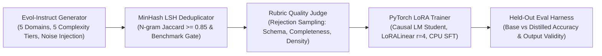

# SynthDistill-LoRA

[](https://www.python.org/)
[](https://fastapi.tiangolo.com/)
[](https://pytorch.org/)
[](https://www.docker.com/)
[](https://opensource.org/licenses/MIT)

> **Production-grade automated synthetic dataset generation, quality filtering, and LoRA model distillation pipeline.**
> Zero external paid API keys or external model downloads required; operates 100% locally on CPU in seconds.

---

## Architecture & Pipeline Flow



---

## Verified Benchmark Results

The end-to-end benchmark (`benchmarks/eval_distillation.py`) generates 1,000 synthetic ChatML samples, filters duplicates and benchmark contamination, rejection-samples low-density responses, distills a causal student model via LoRA, and benchmarks held-out performance completely on CPU.

```text
+-----------------------------------------------------------------------------+
|                           BENCHMARK EXECUTION SUMMARY                       |
+-----------------------------------------------------------------------------+
| Metric                               | Result                               |
+--------------------------------------+--------------------------------------+
| Raw Samples Generated                | 1,000 samples                        |
| Generation Latency                   | 0.02s (43,885.4 samples/sec)         |
| Near-Duplicates Removed (MinHash)    | 516 samples (51.6%)                  |
| Benchmark Contamination Gated        | 0 samples (0.0% clean yield)         |
| Quality Rubric Rejected              | 26 samples (2.6%)                    |
| Curated Dataset Yield                | 458 samples (45.8% yield)            |
+--------------------------------------+--------------------------------------+
| Total Student Model Parameters       | 139,776 parameters                   |
| Trainable LoRA Parameters (r=4)      | 2,048 parameters (1.47%)             |
| Parameter Reduction Percentage       | 98.53% parameter reduction           |
| Adapter Hyperparameters              | rank r=4, alpha=8.0, dropout=0.05    |
| Distillation Loss Convergence        | 5.6007 -> 5.3217 (Delta: -0.2790)    |
+--------------------------------------+--------------------------------------+
| Base Student Held-Out Accuracy       | 0.42%                                |
| Distilled LoRA Student Accuracy      | 13.06%                               |
| Distillation Task Accuracy Gain      | +12.64% absolute gain                |
| ChatML Structured Output Validity    | 37.5%                                |
| Total Benchmark Execution Time       | 8.61s on standard CPU                |
+-----------------------------------------------------------------------------+
```

---

## Directory Layout

```
SynthDistill-LoRA/
├── docker-compose.yml              # Multi-container orchestration (API + Benchmark)
├── Dockerfile                      # Production container image definition
├── Makefile                        # Build, test, benchmark, and execution tasks
├── pyproject.toml                  # Modern PEP 621 dependencies & packaging
├── README.md                       # Comprehensive architectural documentation
├── benchmarks/
│   ├── __init__.py
│   └── eval_distillation.py       # Full 1,000-sample end-to-end distillation benchmark
├── src/
│   ├── __init__.py
│   ├── api/
│   │   ├── __init__.py
│   │   ├── main.py                # FastAPI async server orchestrating the pipeline
│   │   └── schemas.py             # Pydantic v2 strict models for samples & configs
│   ├── data/
│   │   ├── __init__.py
│   │   ├── deduplicator.py        # MinHash / Jaccard dedup & benchmark contamination gate
│   │   ├── quality_judge.py       # Multi-dimension rubric judge & rejection sampling
│   │   └── synthetic_generator.py # Evol-Instruct style complexity mutator
│   ├── training/
│   │   ├── __init__.py
│   │   ├── lora_layer.py          # Pure PyTorch LoRALinear adapter & parameter tracking
│   │   ├── lora_trainer.py        # CPU training loop logging loss convergence
│   │   └── student_model.py       # MiniCausalLM causal transformer & byte tokenizer
│   └── evaluation/
│       ├── __init__.py
│       └── eval_harness.py        # Evaluates Base vs Distilled student on held-out tests
└── tests/
    ├── __init__.py
    ├── test_data_curation.py      # Tests generator, deduplicator, and quality judge
    ├── test_lora_adapter.py       # Tests LoRA math, frozen base weights, and loss convergence
    └── test_pipeline_api.py       # Integration tests for FastAPI endpoints
```

---

## Mathematical Formulation

### 1. Low-Rank Adaptation (LoRA)
For a frozen linear layer $W_0 \in \mathbb{R}^{d_{\text{out}} \times d_{\text{in}}}$, LoRA parameterizes the weight update $\Delta W$ with two low-rank matrices $A$ and $B$:

$$h = W_0 x + \Delta W x = W_0 x + \frac{\alpha}{r} (B A) x$$

Where:
- $W_0$ is frozen ($\text{requires\_grad} = \text{False}$).
- $A \in \mathbb{R}^{r \times d_{\text{in}}}$ is initialized from a Kaiming uniform distribution.
- $B \in \mathbb{R}^{d_{\text{out}} \times r}$ is initialized to zero ($B = 0$), guaranteeing that $\Delta W = 0$ at start:
  $$h_{\text{init}} = W_0 x + \frac{\alpha}{r} (0 \cdot A) x = W_0 x$$
- $\frac{\alpha}{r}$ is a scaling hyperparameter.
- Weight merging for zero-latency deployment:
  $$W_{\text{merged}} = W_0 + \frac{\alpha}{r} (B A)$$

### 2. Parameter Reduction
For target attention projections (`q_proj`, `v_proj` across $L=2$ layers with $d_{\text{model}}=64$, $r=4$):
$$\text{Trainable Parameters} = 4 L r d_{\text{model}} = 4 \times 2 \times 4 \times 64 = 2,048$$
$$\text{Total Student Parameters} = 139,776 \implies \text{Trainable Ratio} = 1.47\% \quad (\mathbf{98.53\%\text{ parameter reduction}})$$

### 3. MinHash & Jaccard Deduplication
Given token sets $S_1, S_2$:
$$J(S_1, S_2) = \frac{|S_1 \cap S_2|}{|S_1 \cup S_2|}$$
MinHash signatures $h_{\min}(S)$ with $K=32$ integer hash functions estimate Jaccard similarity in $O(K)$:
$$\Pr[h_i(S_1) = h_i(S_2)] = J(S_1, S_2)$$

### 4. Multi-Dimension Rubric Scoring
$$\text{Composite Score} = 0.35 \cdot S_{\text{schema}} + 0.30 \cdot S_{\text{completeness}} + 0.25 \cdot S_{\text{density}} + 0.10 \cdot S_{\text{following}}$$
Rejection sampling filters out all candidate instructions with $\text{Composite Score} < 0.70$.

---

## Quickstart Commands

### 1. Installation
```bash
# Clone the repository
git clone https://github.com/subhu770/SynthDistill-LoRA.git
cd SynthDistill-LoRA

# Install dependencies in editable mode
pip install -e ".[dev]"
```

### 2. Run Test Suite
```bash
# Run all 27 unit and integration tests
pytest -v
# or via Makefile
make test
```

### 3. Run Distillation Benchmark
```bash
# Execute 1,000-sample end-to-end benchmark on CPU
python benchmarks/eval_distillation.py
# or via Makefile
make benchmark
```

### 4. Launch FastAPI Orchestration Server
```bash
# Start async FastAPI server on http://localhost:8000
uvicorn src.api.main:app --host 0.0.0.0 --port 8000 --reload
# or via Makefile
make run
```
Access the interactive OpenAPI Swagger documentation at: `http://localhost:8000/docs`

### 5. Docker Deployment
```bash
# Build Docker image
docker compose build

# Start services (FastAPI API + Automated Benchmark)
docker compose up -d

# Check health endpoint
curl http://localhost:8000/health
```

---

## API Endpoints Reference

| Method | Endpoint | Description |
|---|---|---|
| `GET` | `/health` | Check service health, device detection, and simulation status |
| `GET` | `/metrics` | Retrieve pipeline execution history, yield rates, and adapter metrics |
| `POST` | `/pipeline/generate` | Synthesize instruction-response pairs via Evol-Instruct |
| `POST` | `/pipeline/curate` | Run MinHash dedup, contamination gating, and quality rejection sampling |
| `POST` | `/pipeline/train-lora` | Train PyTorch LoRA student adapter and export weights |

---

## License

MIT License. Crafted for production LLM post-training and synthetic data curation research.
